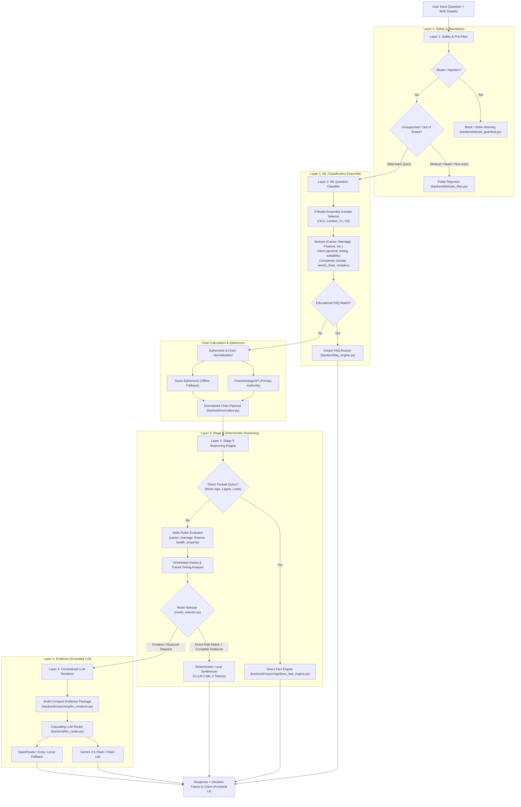
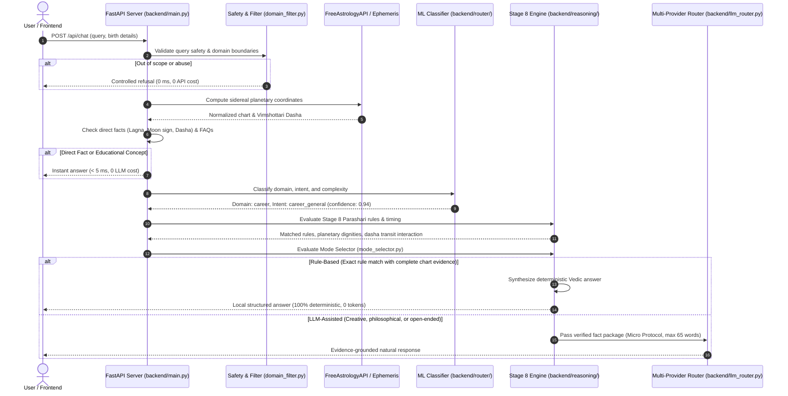

# Astro AI Chatbot

> **Hybrid Vedic Astrology Conversational AI Engine**  
> Combines deterministic Parashari rule engines, local ML intent classification ensembles, and an evidence-grounded cascading LLM renderer to deliver zero-hallucination astrological guidance.

---

## 🏛️ System Architecture

The Astro AI Chatbot is built as a **4-Layer Hybrid Vedic AI System**. It guarantees that an LLM is never allowed to calculate or invent astrological positions. Instead, planetary facts and classical Vedic rules are evaluated deterministically first.



---

## 🔄 End-to-End Execution Flow



---

## 📂 Repository Structure & Component Guide

```
Astro-AI-Chatbot/
├── backend/
│   ├── main.py                     # FastAPI core server & chat pipeline
│   ├── .env                        # Environment keys (FreeAstrologyAPI, Gemini)
│   ├── requirements.txt            # Python dependencies
│   ├── qa_database.json            # Curated knowledge base (76 FAQs, 85 rules)
│   ├── domain_filter.py            # Layer 1 out-of-scope pre-filter
│   ├── abuse_guardrail.py          # Session security & prompt injection protection
│   ├── faq_engine.py               # Educational concept matcher
│   ├── normalize.py                # Birth chart payload normalizer
│   ├── ephemeris.py                # Swiss Ephemeris C-library offline fallback
│   ├── services.py                 # FreeAstrologyAPI client connectors
│   ├── llm_router.py               # Cascading LLM router & token usage tracker
│   │
│   ├── models/question_classifier/ # Offline-trained ML classifier models
│   │   ├── domain_model.pkl        # Domain classification model (OLD)
│   │   ├── domain_model_context_v1.pkl # Domain classification model (Context V1)
│   │   ├── domain_model_v3.pkl     # Domain classification model (V3)
│   │   ├── intent_model.pkl        # Intent classification model
│   │   ├── complexity_model.pkl    # Query complexity model
│   │   └── router_config.json      # Model metadata and threshold configs
│   │
│   ├── router/                     # ML inference & ensemble pipeline
│   │   ├── pipeline.py             # Classification orchestrator
│   │   ├── model_selector.py       # 3-model ensemble confidence voter
│   │   ├── domain.py               # Domain prediction module
│   │   ├── intent.py               # Intent prediction module
│   │   └── complexity.py           # Complexity prediction module
│   │
│   ├── reasoning/                  # Stage 8 Deterministic Astrological Rules (31 modules)
│   │   ├── stage8_pipeline.py      # Master Vedic rule pipeline orchestrator
│   │   ├── career_rules.py         # 10th house & 10th lord professional indicators
│   │   ├── marriage_rules.py       # 7th house & 7th lord relationship dynamics
│   │   ├── finance_rules.py        # 2nd & 11th house wealth and income rules
│   │   ├── education_rules.py      # 4th & 5th house academic & intellect rules
│   │   ├── health_rules.py         # 6th house vitality & wellness indicators
│   │   ├── property_rules.py       # 4th house land and asset rules
│   │   ├── direct_fact_engine.py   # Instant extraction for Lagna, Moon, lords (< 5 ms)
│   │   ├── answer_synthesizer.py   # Local natural language Vedic answer builder
│   │   ├── mode_selector.py        # 5-tier routing decision hierarchy
│   │   ├── rule_coverage.py        # Relevance & boundary protection evaluator
│   │   ├── structured_evidence.py  # Fact package extractor for local answers
│   │   ├── llm_renderer.py         # Micro-prompt evidence restrictor for Gemini
│   │   ├── lordship.py             # Natal house rulership calculations
│   │   ├── dignity.py              # Exaltation, debilitation & strength analysis
│   │   ├── dasha_timing.py         # Vimshottari period activation rules
│   │   └── transit_timing.py       # Planetary transit (Gochara) evaluation
│   │
│   └── astrology/                  # Astronomical calculation helpers
│       ├── dasha.py                # Vimshottari dasha hierarchy computations
│       └── transit.py              # Planetary transit longitude computations
│
├── frontend/                       # Interactive Web Chat Interface
│   ├── index.html                  # Modern chat UI
│   └── script.js                   # XSS-sanitized streaming renderer
│
├── tests/                          # Automated Regression & Security Test Suites
│   ├── test_xss_prevention.js      # 20 frontend security & DOM injection tests
│   └── test_career_evidence_builder.py # Unit tests for deterministic evidence builder
│
├── scratch/                        # Observability & Benchmark Suites
│   ├── test_master_40_verification_suite.py # 40-question benchmark (Local vs. LLM)
│   ├── verify_llm_token_observability.py    # LLM token telemetry verification
│   └── test_frontend_xss_security.py       # Security test runner
│
├── run.py                          # Production Uvicorn server launcher
├── train_batches.py                # ML model retraining pipeline
└── validate_model.py               # Model validation & benchmarking suite
```

---

## 🎯 The 5-Tier Decision Hierarchy

Every user request is routed using an explicit waterfall hierarchy:

| Tier | Name | Condition | Action | LLM Calls | Latency |
| :---: | :--- | :--- | :--- | :---: | :---: |
| **Tier 1** | **`UNSUPPORTED`** | Clinical medical claims, exact death dates, lottery, or non-astro queries | Controlled ethical disclaimer / boundary refusal | **0** | $< 2\text{ ms}$ |
| **Tier 0** | **`DIRECT` / `FAQ`** | Direct chart lookup (Lagna, Moon sign, Dasha) or concept FAQ | Instant retrieval from normalized chart or `qa_database.json` | **0** | $< 5\text{ ms}$ |
| **Tier 4** | **`UNRESOLVED`** | Missing required birth data or coordinates | User prompt to supply birth details | **0** | $< 2\text{ ms}$ |
| **Tier 2** | **`RULE_BASED`** | Exact Stage 8 rule match AND complete chart evidence | Local deterministic synthesis via `answer_synthesizer.py` | **0** | $10\text{--}25\text{ ms}$ |
| **Tier 3** | **`LLM_ASSISTED`** | Valid domain question requiring nuanced, creative synthesis | Send verified facts only to Gemini (Micro Protocol, 40–65 words) | **1** | $400\text{--}900\text{ ms}$ |

---

## 🚀 Quick Start Guide

### 1. Prerequisites
* Python 3.10+ / 3.11+
* Node.js (for frontend security test execution)

### 2. Installation
```bash
# Clone the repository
git clone https://github.com/krishna-dhawangale/astro-ai-chatbot.git
cd astro-ai-chatbot

# Create and activate virtual environment
python -m venv venv
# On Windows:
.\venv\Scripts\activate
# On Linux/macOS:
source venv/bin/activate

# Install dependencies
pip install -r backend/requirements.txt
```

### 3. Environment Configuration
Create a `.env` file in `backend/.env`:
```env
GEMINI_API_KEY=your_gemini_api_key_here
FREE_ASTROLOGY_API_KEY=your_freeastrologyapi_key_here
```

### 4. Running the Application
```bash
python run.py
```
* **Web Chat UI**: [http://localhost:8000/](http://localhost:8000/)
* **Interactive API Documentation (Swagger)**: [http://localhost:8000/docs](http://localhost:8000/docs)

---

## 🧪 Testing & Verification

```bash
# 1. Frontend Security & XSS Prevention (20 Tests)
node tests/test_xss_prevention.js

# 2. Deterministic Career Evidence Unit Tests
python tests/test_career_evidence_builder.py

# 3. LLM Token Observability & Trace Verification
python scratch/verify_llm_token_observability.py

# 4. Master 40 Verification Benchmark
python scratch/test_master_40_verification_suite.py
```